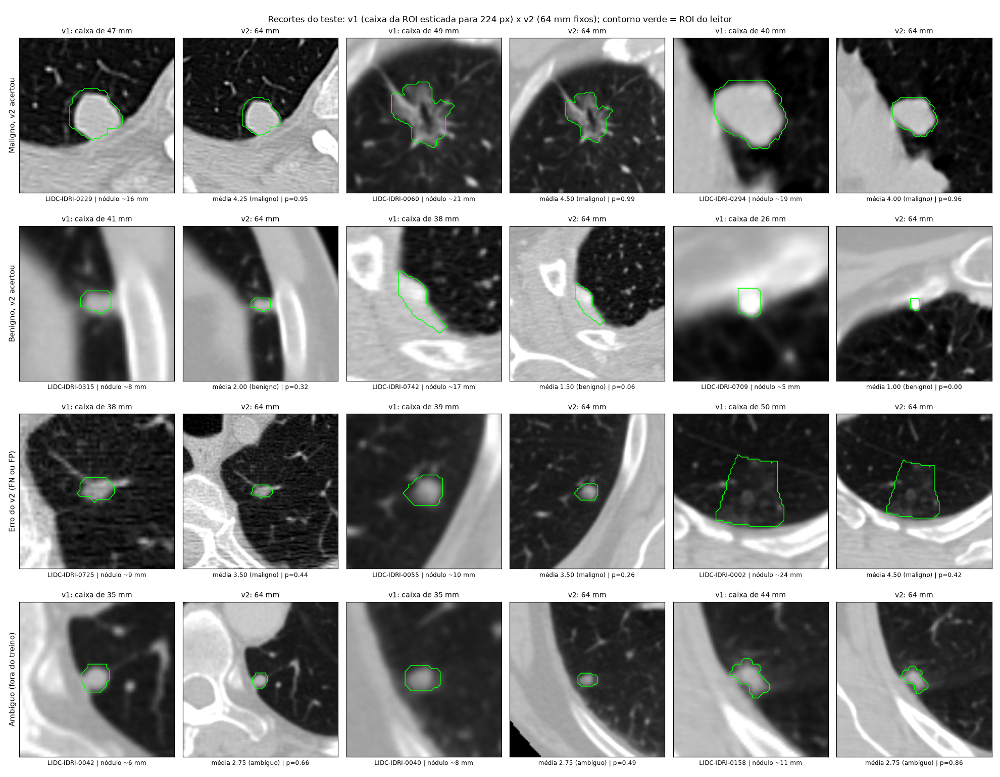
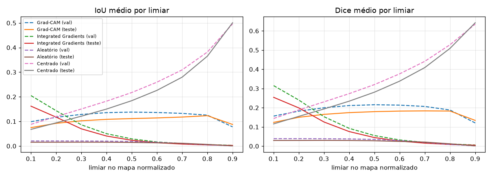
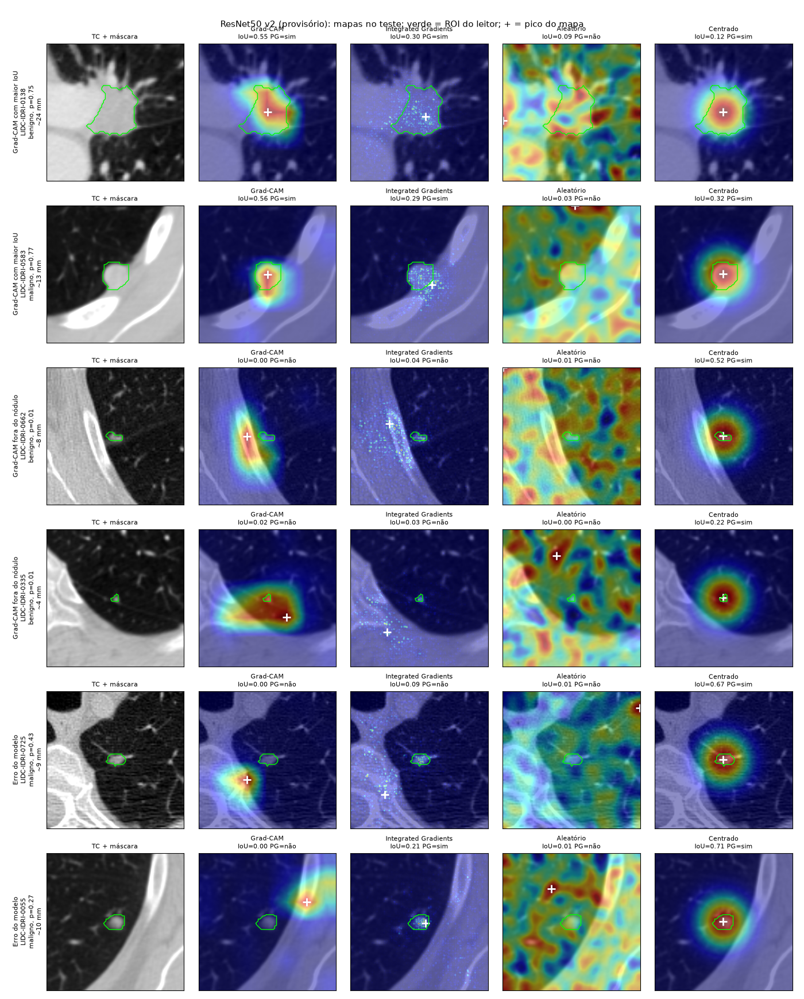

# Sprint 5 — Validação estatística e baselines (Gabriel)

**Status de todos os números abaixo: PROVISÓRIO.** Eles vêm do ResNet50 de semente única do treino completo (`models/resnet50/resnet50_sprint3_best.pth`, 12/10), não do ensemble oficial do André. Quando as previsões oficiais chegarem, basta rodar `scripts/sprint5_evaluate.py` de novo com `--status oficial`.

## Dados avaliados

- Divisão por paciente de 559 pacientes (391/84/84), seed 42, reproduzida a partir do notebook `notebooks/03-resnet50-sprint3.ipynb`. Os números de patches, pacientes e malignos por conjunto bateram exatamente com `outputs/sprint3/split_summary.csv`.
- Teste: 84 pacientes, 4.163 patches (75,4% malignos), **687 nódulos** (70,2% malignos).
- Unidade de análise: nódulo anotado por um leitor (`patient_id | study_uid | reading_session | nodule_id`). O score do nódulo é a média das probabilidades dos seus patches. O rótulo foi constante dentro de todos os nódulos.
- Observação para o Matheus: o `split_summary.csv` reporta 454 "nódulos" no teste porque conta valores distintos de `nodule_id` sem considerar o paciente. Agrupando por paciente e `nodule_id` são 684, e por paciente, exame, leitor e `nodule_id` são 687.
- Manifesto com os IDs de todos os patches por conjunto: `outputs/sprint5/split_manifest.csv`.

## Verificação das previsões

As previsões do ResNet50 foram geradas de novo a partir do checkpoint, com a mesma normalização do notebook. A matriz de confusão por patch reproduziu exatamente a oficial (`outputs/sprint3/test_results_resnet50.csv`): TN = 528, FP = 496, FN = 756, TP = 2.383. Isso confirma que cada previsão está ligada ao rótulo e ao ID corretos.

## Método

As métricas foram calculadas por nódulo no limiar fixo de 0,5, sem ajuste no teste. Os intervalos de confiança de 95% vêm de um bootstrap por cluster: 1.000 reamostragens dos 84 pacientes com reposição (seed 42), levando todos os nódulos de cada paciente sorteado, com IC por percentil. Nenhuma reamostragem ficou com uma classe só. O "sempre maligno" e a CNN simples foram avaliados nos mesmos 687 nódulos.

A CNN simples é a `ImageCNN` de `scripts/train_from_crops.py`, treinada nesta mesma divisão: 5 épocas, `pos_weight` igual a benignos/malignos, e a melhor época (a 2) escolhida pela AUC da validação. A configuração está em `models/custom_cnn_559/config.json`.

## Resultados (por nódulo, IC 95% por paciente)

| Métrica | Sempre maligno | CNN simples | ResNet50 (provisório) |
|---|---|---|---|
| **AUC** | 0,500 | 0,611 [0,542; 0,685] | **0,712 [0,651; 0,776]** |
| **Sensibilidade** | 1,000 | 0,135 [0,062; 0,223] | 0,743 [0,667; 0,815] |
| **Especificidade** | 0,000 | 0,922 [0,811; 1,000] | 0,512 [0,404; 0,620] |
| **Acurácia balanceada** | 0,500 | 0,528 [0,484; 0,567] | **0,627 [0,575; 0,685]** |
| Acurácia | 0,702 [0,646; 0,755] | 0,370 [0,312; 0,431] | 0,674 [0,619; 0,729] |
| Precisão | 0,702 [0,646; 0,755] | 0,802 [0,632; 1,000] | 0,782 [0,730; 0,836] |
| F1 | 0,825 [0,785; 0,860] | 0,231 [0,117; 0,347] | 0,762 [0,707; 0,811] |
| TN/FP/FN/TP | 0/205/0/482 | 189/16/417/65 | 105/100/124/358 |

### Limiar escolhido na validação (Youden)

O limiar foi escolhido pela estatística de Youden (máximo de sensibilidade + especificidade − 1), usando **só os nódulos de validação** (84 pacientes, separados do teste). Depois foi aplicado uma única vez no teste. A AUC não muda, porque ela não depende do limiar.

| Métrica | ResNet50 (0,5) | ResNet50 (limiar da validação = 0,599) | CNN simples (0,5) | CNN simples (limiar da validação = 0,303) |
|---|---|---|---|---|
| Sensibilidade | 0,743 [0,667; 0,815] | 0,660 [0,569; 0,740] | 0,135 [0,062; 0,223] | 0,645 [0,560; 0,735] |
| Especificidade | 0,512 [0,404; 0,620] | 0,595 [0,507; 0,683] | 0,922 [0,811; 1,000] | 0,512 [0,394; 0,626] |
| Acurácia balanceada | 0,627 [0,575; 0,685] | 0,627 [0,574; 0,682] | 0,528 [0,484; 0,567] | 0,579 [0,529; 0,633] |
| Acurácia | 0,674 | 0,640 | 0,370 | 0,606 |
| TN/FP/FN/TP | 105/100/124/358 | 122/83/164/318 | 189/16/417/65 | 105/100/171/311 |

- **ResNet50:** o limiar da validação só troca erros de um tipo por outro, com 17 falsos positivos a menos e 40 falsos negativos a mais. A acurácia balanceada fica igual. O limite do modelo é a separação entre as classes (AUC 0,712), e ajustar o limiar não resolve. Para melhorar, é preciso retreinar com outro rótulo, outro recorte, augmentation e critério de época pela AUC.
- **CNN simples:** o limiar da validação corrige o viés para "benigno", e a acurácia balanceada sobe de 0,528 para 0,579. Mesmo assim, continua abaixo do ResNet50.
- O limiar oficial do ResNet50 (0,5 ou o da validação) é uma escolha de operação. Ela precisa ser decidida pelo grupo e registrada antes de citar sensibilidade e especificidade.

Referência por patch, sem IC, porque os patches não são independentes: o ResNet50 tem AUC 0,709, acurácia balanceada 0,637 e acurácia 0,699. Essa acurácia de 0,699 é o número que aparecia como "70%".

Arquivos: `outputs/sprint5/metrics_provisorio.csv`, `metrics_patch_reference_provisorio.csv` e `run_meta_provisorio.json` (traz os hashes dos arquivos de entrada).

## Interpretação

- **Acurácia engana neste teste.** O "sempre maligno" acerta 70,2% dos nódulos, mais que o ResNet50 (67,4%), sem aprender nada. A comparação correta usa a AUC e a acurácia balanceada.
- **O ResNet50 aprende algo além da prevalência.** A AUC de 0,712 tem IC inteiro acima de 0,5, e a acurácia balanceada de 0,627 [0,575; 0,685] fica acima do 0,5 do "sempre maligno".
- **O desempenho ainda é modesto.** O modelo erra metade dos benignos (especificidade 0,512) e perde 124 de 482 nódulos malignos (sensibilidade 0,743).
- **Os ICs são largos**, com amplitude de cerca de 0,12 na AUC, porque o teste tem só 84 pacientes. Diferenças pequenas entre modelos não podem ser afirmadas.
- **A CNN simples é inferior ao ResNet50 na AUC** (0,611 contra 0,712), embora os ICs se sobreponham um pouco. No limiar de 0,5 ela quase só responde "benigno" (sensibilidade 0,135), porque o `pos_weight` menor que 1 puxa as probabilidades para baixo. Isso é um problema de limiar, não de ranking; com o limiar escolhido na validação, a acurácia balanceada dela sobe para 0,579 (ver tabela acima).

## Retreino: ResNet50 v2 (mesma divisão de 559 pacientes)

Script: `scripts/sprint5_retrain_resnet50.py`. Configuração em `models/resnet50_v2/config.json` e histórico em `models/resnet50_v2/training_history.csv`. As mudanças em relação ao modelo do notebook (v1) foram decididas antes de olhar o teste:

1. **Rótulo de consenso.** Antes, cada leitor dava seu próprio rótulo (≥ 3). Agora o rótulo é a média de malignidade dos leitores que anotaram o **mesmo nódulo físico**, e o nódulo é maligno quando a média é ≥ 3,5. O nódulo físico é encontrado ligando as ROIs de leitores diferentes cujas caixas se sobrepõem na mesma fatia.
2. **Ambíguos fora do treino e da validação.** São os nódulos com média entre 2,5 e 3,5, que correspondem a 36% dos patches de teste. No teste, os resultados aparecem com e sem eles.
3. **Recorte fixo de 64 mm** ao redor do centro da ROI, usando o `PixelSpacing`, redimensionado para 224. Antes, cada caixa era esticada para 224, e o modelo perdia a noção do tamanho do nódulo.
4. **Augmentation** com rotação de 90°, flip e deslocamento de até 12 px.
5. **Checkpoint pela AUC da validação** por nódulo, com early stopping (paciência de 4). A melhor época foi a 1, com AUC de validação de 0,922. Depois disso, a perda de treino continuou caindo e a validação piorou, o que é sinal de que o modelo começa a decorar rápido.

O rótulo novo muda o teste: no teste com todos os nódulos, só 26,1% dos nódulos são malignos (antes eram 70,2%). Para comparar de forma justa, **o v1 também foi reavaliado com os rótulos novos** (`preds_test_resnet50_v1_labelv2.csv`), com as mesmas probabilidades e só o rótulo trocado. Manifesto: `outputs/sprint5/split_manifest_v2.csv`.

**Teste com todos os nódulos** (687 nódulos de leitor, 84 pacientes, 26,1% malignos). Arquivo: `metrics_provisorio_v2_todos.csv`.

| Métrica | Sempre maligno | v1 (rótulo novo) | **v2** |
|---|---|---|---|
| AUC | 0,500 | 0,818 [0,755; 0,877] | **0,906 [0,852; 0,948]** |
| Sensibilidade (0,5) | 1,000 | 0,978 | 0,860 [0,774; 0,932] |
| Especificidade (0,5) | 0,000 | 0,443 | 0,764 [0,676; 0,854] |
| Acurácia balanceada (0,5) | 0,500 | 0,710 [0,663; 0,752] | **0,812 [0,747; 0,866]** |
| Acurácia balanceada (limiar da validação) | 0,500 | 0,754 (limiar 0,720) | 0,794 (limiar 0,601) |
| TN/FP/FN/TP (0,5) | 0/508/0/179 | 225/283/4/175 | 388/120/25/154 |

**Teste sem os ambíguos** (380 nódulos, 72 pacientes, 47,1% malignos). Arquivo: `metrics_provisorio_v2_sem_ambiguos.csv`.

| Métrica | Sempre maligno | v1 (rótulo novo) | **v2** |
|---|---|---|---|
| AUC | 0,500 | 0,883 [0,810; 0,943] | **0,949 [0,901; 0,984]** |
| Sensibilidade (0,5) | 1,000 | 0,978 | 0,860 [0,772; 0,935] |
| Especificidade (0,5) | 0,000 | 0,592 | 0,900 [0,800; 0,977] |
| Acurácia balanceada (0,5) | 0,500 | 0,785 [0,719; 0,856] | **0,880 [0,815; 0,933]** |
| TN/FP/FN/TP (0,5) | 0/201/0/179 | 119/82/4/175 | 181/20/25/154 |

**Leitura:**
- Com o mesmo teste e os mesmos rótulos, o v2 é melhor que o v1. A AUC sobe de 0,818 para 0,906 e a acurácia balanceada de 0,710 para 0,812, e o IC do v2 fica acima da estimativa pontual do v1. A melhora vem do treino: recorte em mm, augmentation e escolha da época.
- **A troca de rótulo, sozinha, também muda bastante o número.** O mesmo v1 tem AUC de 0,712 com o rótulo por leitor ≥ 3 e de 0,818 com o rótulo de consenso. O rótulo antigo era mais ruidoso, porque 3 é "indeterminado". Mas isso significa que **a tarefa mudou**, e os números do v2 não podem ser comparados com os do v1 no rótulo antigo.
- Sem os ambíguos, a tarefa fica mais fácil: AUC de 0,949. Por isso, a visão com todos os nódulos tem que aparecer sempre ao lado.
- O v2 erra para o lado oposto do v1: deixa passar 25 malignos (contra 4 do v1), mas marca bem menos benignos por engano (120 contra 283). Escolher o limiar é uma decisão de operação do grupo.
- **Decisão do grupo pendente:** adotar o rótulo de consenso muda a prevalência do teste. A frase "cerca de 75% maligno" deixa de valer, e passa a ser 26% dos nódulos e 41% dos patches. Isso precisa entrar nas decisões (D6) e na tabela do Wesley antes de virar número oficial.

### Conferência visual dos recortes (v1 x v2)



A figura mostra 12 casos do teste, cada um de um nódulo físico diferente, sorteados com seed 42 dentro de quatro grupos: maligno que o v2 acertou, benigno que o v2 acertou, erro do v2 e ambíguo. Para cada caso aparece o patch com a maior ROI. À esquerda fica o recorte v1 (a caixa da ROI mais 20 px de margem, esticada para 224 px) e à direita o recorte v2 (64 mm fixos). O contorno verde é a ROI do leitor; `p` é a probabilidade de maligno dada pelo v2. Os IDs, tamanhos e probabilidades estão em `figures/recortes_v1_v2_casos.csv`. Para gerar de novo: `.venv\Scripts\python.exe scripts\sprint5_crop_preview.py`, que leva cerca de 3 minutos.

O que a figura mostra:
- **O recorte v2 está correto.** O contorno cai sobre o nódulo e o nódulo fica no centro em todos os casos.
- **O v1 distorce o tamanho.** A caixa do v1 varia de 26 a 50 mm, conforme o nódulo. Um nódulo de 5 mm (LIDC-IDRI-0709) aparece grande no v1 e pequeno no v2. No v2, a escala é a mesma para todos, e o tamanho volta a ser uma informação que o modelo pode usar. Isso combina com a melhora do v2.
- **Nódulos muito pequenos ocupam poucos pixels no v2.** Um nódulo de 5 mm fica com cerca de 18 px de 224. É um argumento para testar recortes de vários tamanhos (por exemplo, 32 e 64 mm).
- **Dois dos três erros estão bem na fronteira do rótulo.** LIDC-IDRI-0725 e LIDC-IDRI-0055 têm média exatamente 3,50, o mínimo para contar como maligno, e o v2 deu p = 0,44 e 0,26. O terceiro (LIDC-IDRI-0002, 24 mm, média 4,5, p = 0,42) é um erro claro em um nódulo grande colado na pleura.
- **Os ambíguos recebem probabilidades espalhadas** (0,49 a 0,86), o que é esperado, já que esses casos ficaram fora do treino.
- **O nódulo está sempre no centro**, tanto no v1 quanto no v2. Por isso, um mapa de explicabilidade que aponta só para o centro continua acertando no Pointing Game, e a ressalva da Débora vale também para o v2.

## Explicabilidade do v2 — versão mínima (PROVISÓRIO)

Script: `scripts/sprint5_xai_v2.py`, que leva cerca de 8 minutos. Saídas:
- `outputs/sprint5/xai_v2_per_case.csv` (IDs e métricas por caso);
- `xai_v2_summary.csv`;
- `xai_v2_threshold_sweep.csv`;
- `docs/sprint5/figures/xai_v2_*.png`.

Esta análise **não substitui a da Débora**. É uma primeira medição no v2, com o mesmo protocolo pedido na sprint.

**Protocolo:**
- **Amostra:** um patch por nódulo físico, o de maior ROI. São 241 nódulos na validação e 275 no teste (84 pacientes), incluindo os ambíguos.
- **Quatro mapas**, todos para a classe prevista pelo v2:
  - Grad-CAM na `layer4`;
  - Integrated Gradients (baseline de ar, 32 passos, valor absoluto somado nos canais);
  - **aleatório** (ruído suavizado);
  - **centrado** (gaussiana no centro do recorte, σ = 8 mm).
- **Referência:** a máscara é a ROI de um leitor (a do patch).
- **Métricas:**
  - IoU e Dice depois de binarizar o mapa normalizado num limiar;
  - Pointing Game: o pico do mapa cai na máscara dilatada em 15 px, cerca de 4,3 mm;
  - "pico dentro da máscara", sem tolerância;
  - distância do pico ao centro da máscara.
- **Limiar:** a varredura vai de 0,1 a 0,9. Cada mapa usa o limiar de **maior IoU médio na validação**, aplicado uma vez no teste: Grad-CAM 0,5, IG 0,1, aleatório 0,2 e centrado 0,9.

**Teste (275 nódulos, IC 95% por paciente):**

| Mapa | IoU | Dice | Pointing Game (±4,3 mm) | Pico dentro da máscara | Distância do pico (mm) |
|---|---|---|---|---|---|
| Grad-CAM | 0,112 [0,093; 0,133] | 0,180 | 42,2% [36,9; 48,5] | 30,2% | 9,0 [8,1; 9,8] |
| Integrated Gradients | 0,162 [0,136; 0,192] | 0,254 | 66,5% [58,0; 75,0] | 55,6% | 7,8 [6,5; 9,2] |
| Aleatório | 0,015 | 0,030 | 1,5% | 0,0% | 33,8 |
| **Centrado** | **0,501 [0,469; 0,535]** | **0,642** | **100%** | 99,6% | 0,5 |

**Por acerto do modelo e por tamanho do nódulo** (Pointing Game e IoU no teste):

| Grupo | n | Grad-CAM PG | Grad-CAM IoU | IG PG | IG IoU | Centrado IoU |
|---|---|---|---|---|---|---|
| Acerto | 124 | 57,3% | 0,138 | 79,0% | 0,190 | 0,458 |
| Erro | 23 | 17,4% | 0,093 | 65,2% | 0,215 | 0,573 |
| Ambíguo | 128 | 32,0% | 0,089 | 54,7% | 0,126 | 0,529 |
| < 6 mm | 86 | 31,4% | 0,042 | 43,0% | 0,067 | 0,391 |
| 6–10 mm | 118 | 28,0% | 0,085 | 69,5% | 0,158 | 0,668 |
| 10–20 mm | 51 | 72,5% | 0,238 | 90,2% | 0,276 | 0,440 |
| ≥ 20 mm | 20 | 95,0% | 0,242 | 90,0% | 0,305 | 0,143 |





Na figura de exemplos, cada linha é um caso do teste: dois com o maior IoU do Grad-CAM, dois em que o Grad-CAM fica fora do nódulo e dois erros do modelo. O contorno verde é a ROI do leitor e o `+` marca o pico de cada mapa.

**Leitura:**
- **O mapa centrado vence todos os outros com folga**: IoU de 0,50 e Pointing Game de 100%. Isso confirma a crítica dos mentores. Como todo recorte é centrado no nódulo, uma métrica de localização nesses recortes **não prova** que a rede olha para o nódulo. Para o Grad-CAM e o IG ganharem significado, eles precisam ser comparados com o centrado, e não com um valor absoluto.
- **O Grad-CAM do v2 localiza mal**: Pointing Game de 42% e IoU de 0,11, com pico a cerca de 9 mm do centro do nódulo. Nos exemplos, ele marca com frequência a **pleura ou a parede torácica** ao lado do nódulo. Isso é **um resultado a investigar, não um defeito a esconder**: o modelo pode estar usando o contexto, como a proximidade da pleura, como atalho. A resolução da `layer4` (7×7, cada célula com cerca de 9 mm) também limita o IoU, sobretudo em nódulos pequenos.
- **O IG localiza melhor que o Grad-CAM** (Pointing Game de 66%), mas seus mapas são esparsos, e o melhor limiar fica na ponta da varredura (0,1). O baseline de ar favorece pixels claros, e o nódulo é claro, então parte do acerto pode vir do contraste e não do modelo. O teste de Adebayo no v2 é que vai separar uma coisa da outra.
- **O tamanho importa**: em nódulos com 10 mm ou mais, o Grad-CAM acerta 72 a 95% no Pointing Game; abaixo de 10 mm, só cerca de 30%. Nos erros do modelo, o Grad-CAM cai no nódulo em só 17% dos casos.
- **Relação com a meta do README (IoU ≥ 0,40):** o Grad-CAM e o IG ficam bem abaixo da meta. O centrado, que não aprende nada, passa dela. A meta de IoU, sozinha, não serve como critério de sucesso nestes recortes.

**Limitações:**
- a análise é provisória, sobre o v2 de uma semente;
- a máscara é de um único leitor;
- o centrado usa σ fixo e seu melhor limiar ficou no topo da varredura;
- o teste de Adebayo (randomização de pesos e de rótulos) ainda não foi feito no v2;
- a análise da Débora e o teste de deslocamento (André e Débora) continuam necessários.

## Teste com rótulos embaralhados (Adebayo, randomização de rótulos)

- **O que foi embaralhado:** os rótulos de treino e de validação, permutados aleatoriamente **por patch** (seed 42; células "ADEBAYO: LABEL RANDOMIZATION" do notebook). A permutação mantém a proporção de classes. Um ResNet50 novo, pré-treinado no ImageNet, foi treinado com esses rótulos. Depois, o Grad-CAM dele foi comparado com o do modelo original usando a correlação de Spearman, nos dois casos para a classe prevista pelo modelo original.
- **O que se esperava:** o modelo com rótulos aleatórios não deveria acertar acima do acaso, e os mapas deveriam ficar diferentes dos do modelo original (Spearman perto de 0).
- **O que aconteceu** (`outputs/sprint3/adebayo_label_randomization_results.csv`, 100 casos):
  - Spearman mediana de 0,029 (IQR de -0,152 a 0,197), com só 6% dos casos acima de 0,5. Os mapas mudaram, como esperado para o Grad-CAM.
  - O modelo com rótulos embaralhados acertou 62% desses 100 casos. O modelo original acertou 51%, e a classe majoritária daquela amostra é 53%. Os dois modelos concordaram em 61% das previsões.
- **Leitura:** a parte dos mapas está coerente com o esperado. A parte do desempenho é **um alerta, não uma aprovação**. Um modelo treinado com rótulos aleatórios acertando mais que o original indica que essa amostra é pequena e ruidosa, ou que os patches do mesmo paciente e nódulo são tão parecidos que o modelo decora a aparência deles.
- **Limitação importante:** esse resultado **não é da divisão de 559 pacientes**. O arquivo é de 12/10 às 13:19, antes do treino completo (o checkpoint é de 18:11). O índice máximo, 594, cabe no teste de 598 patches da rodada pequena, e o `scripts/train_full_lidc.py` para antes dessa célula. O notebook atual seleciona 10 casos (`np.linspace`), mas o arquivo tem 100, então o código mudou depois da execução. O desempenho do modelo com rótulos embaralhados também nunca foi medido no teste completo. Rodar de novo na divisão de 559, permutando por paciente, ficou para a Sprint 6.

## Limitações

1. Os números são provisórios e vêm de uma semente, sem ensemble e sem TTA. Não são o modelo oficial do André.
2. A unidade é o nódulo de cada leitor. O mesmo nódulo físico anotado por vários leitores conta mais de uma vez. O bootstrap por paciente corrige os ICs para essa dependência, mas não junta as anotações.
3. O limiar é fixo em 0,5 para todos os modelos. Para a CNN simples isso é claramente desfavorável.
4. Os baselines antigos (`models/custom_cnn`, `semantic_mlp`, `fusion_cnn_mlp`) foram avaliados em outro teste, de 90 casos, e **não são comparáveis**. O MLP semântico e a fusão usam as anotações dos radiologistas como entrada (ver D5).
5. O teste tem só 84 pacientes, e por isso os intervalos são largos.

## Como reproduzir

```text
.venv\Scripts\python.exe scripts\sprint5_predictions.py
.venv\Scripts\python.exe scripts\sprint5_evaluate.py --pred resnet50=outputs/sprint5/preds_test_resnet50.csv --pred cnn_simple=outputs/sprint5/preds_test_cnn_simple.csv --val resnet50=outputs/sprint5/preds_val_resnet50.csv --val cnn_simple=outputs/sprint5/preds_val_cnn_simple.csv --status provisorio
```

Retreino v2 e avaliação (cerca de 20 minutos e 1 minuto):

```text
.venv\Scripts\python.exe scripts\sprint5_retrain_resnet50.py
.venv\Scripts\python.exe scripts\sprint5_evaluate.py --pred resnet50_v2=outputs/sprint5/preds_test_resnet50_v2.csv --pred resnet50_v1=outputs/sprint5/preds_test_resnet50_v1_labelv2.csv --val resnet50_v2=outputs/sprint5/preds_val_resnet50_v2.csv --val resnet50_v1=outputs/sprint5/preds_val_resnet50_v1_labelv2.csv --manifest outputs/sprint5/split_manifest_v2.csv --status provisorio --tag v2_todos
```

Para a visão sem ambíguos, rode o mesmo comando com `--exclude-ambiguous --tag v2_sem_ambiguos`.

O primeiro comando da seção anterior reproduz a divisão, grava o manifesto, gera as previsões do ResNet50 e treina a CNN simples. Leva cerca de 20 minutos com GPU e precisa de `D:\datasetLIDC_completo` e de `outputs/sprint3/dicom_index.csv`. O segundo leva cerca de 20 segundos. Os logs ficam em `outputs/sprint5/predictions_log.txt` e `outputs/sprint5/evaluate_log_provisorio.txt`.

Para o resultado oficial, o arquivo do André precisa ter uma linha por patch de teste (4.163) com `patient_id`, `study_uid`, `reading_session`, `nodule_id`, `label` e `prob_malignant`. A coluna `row_idx` do manifesto é opcional, mas permite conferir linha a linha. O comando fica assim:

```text
.venv\Scripts\python.exe scripts\sprint5_evaluate.py --pred resnet50_oficial=<arquivo do André> --pred cnn_simple=outputs/sprint5/preds_test_cnn_simple.csv --status oficial
```

## Pendências

- [ ] Rodar de novo com as previsões oficiais do André (`--status oficial`).
- [x] Limiar escolhido na validação (Youden), aplicado uma vez no teste.
- [ ] Calcular as diferenças pareadas modelo menos baseline com IC.
- [x] Retreinar o ResNet50 na mesma divisão com rótulo pela média ≥ 3,5, recorte fixo em mm, augmentation e checkpoint pela AUC da validação (v2, semente única).
- [ ] O grupo decidir se o rótulo de consenso (com e sem ambíguos) passa a ser o oficial (D6) e registrar na tabela do Wesley.
- [x] Conferir visualmente uma amostra dos recortes de 64 mm (`figures/recortes_v1_v2.png`).
- [ ] v2: mais seeds ou ensemble e mais regularização, porque a melhor época foi a 1 (sinal de overfitting rápido). Testar recortes de vários tamanhos por causa dos nódulos pequenos.
- [ ] Avaliar por nódulo físico (275 no teste), em vez de por nódulo de leitor.
- [x] Explicabilidade mínima no v2: Grad-CAM, IG, aleatório e centrado; IoU, Dice e Pointing Game; limiar da validação; separação por acerto e por tamanho.
- [ ] Explicabilidade: o teste de Adebayo no v2; investigar por que o Grad-CAM marca a pleura (atalho de contexto?); usar a união das máscaras dos leitores; comparar com a análise da Débora.
- [ ] Conferir slides e documentos contra a tabela de registro do Wesley (acurácia oficial única e 559 pacientes em todo lugar).
- [ ] Rodar de novo o teste de rótulos embaralhados na divisão de 559, permutando por paciente e medindo o desempenho no teste.
- [ ] Passar estes resultados para a tabela de registro do Wesley como "provisório".
